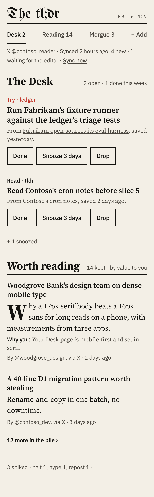
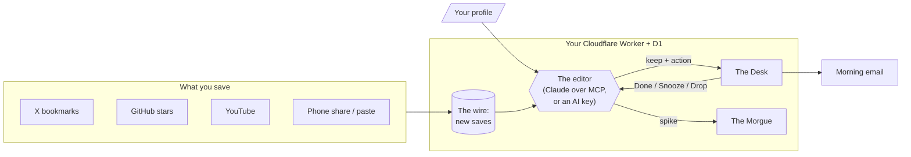

# tl;dr

**A morning paper for the posts you saved and never read.**

tldr reads what you save (X bookmarks, GitHub stars, YouTube videos, and
anything you share from your phone), spikes the slop, writes a short TLDR for
what's worth keeping, and turns the best of it into a few actions tied to what
you're building. You get one page and one email a morning, not another feed.

It runs as one Cloudflare Worker and a D1 database in your own Cloudflare
account, behind Cloudflare Access. **[Live demo](https://khubli.github.io/tldr/)** (made-up
data) · **[Set it up](docs/setup.md)** in about 45 minutes.



## Why tldr

Read-later apps keep everything and summarisers summarise everything. Either
way the pile grows. tldr acts like an editor instead.

- **It cuts.** On a normal day it spikes at least half of what came in, and
  says why: hype, bait, repost, stale, too basic, or off-topic. Anything can
  be rescued from the Morgue.
- **It judges for you, not in general.** Every verdict reads your own
  profile: what you're building and what you already know. Each keep carries
  a "why you" line.
- **It ends in actions.** The best saves become a short Desk of things to
  try, read, apply, post or file, each with Done, Snooze and Drop. The editor
  reads those taps and stops suggesting what you drop.
- **It stays small.** One page, not a feed. Copy nobody touched ages into the
  Morgue after 30 days, so the Desk never piles up.
- **Private by construction.** Your saves and profile live only in your D1
  database. Every page and API checks the Access login and returns nothing
  without it. This repo holds no personal data.
- **Your choice of editor.** Use your Claude plan through a remote MCP
  connector (no API bill), or let the Worker run the editor with a Claude
  API, OpenRouter or OpenAI-compatible key.
- **Allowed access only.** X through its official API (your own bookmarks),
  YouTube and X embeds for shared links, GitHub's REST API. No scraping.
- **It looks like a newspaper.** Newsprint, ink, hairline rules and one spot
  red, not a dashboard.

**What it is not:** a feed reader, a social client, or a tool that posts for
you. **Who it's for:** one person who saves more than they read and is happy
to spend an evening with Cloudflare and a terminal.

## How it works



More in [docs/how-it-works.md](docs/how-it-works.md).

## How capture works

- **Share from the phone.** Install the site as an app in Android Chrome; it
  then appears in the share sheet. Shares post to `/share`.
- **Paste.** "+ File copy" on the Desk opens a paste box that posts to `/save`.
- **X bookmarks.** Connect X once from the page. The first sync pulls every
  bookmark X will return; after that a cron reads small pages every 3 hours
  and stops at the first page with nothing new, so you pay (X's owned-read
  price, $0.001 per post) for little more than your new bookmarks.
- **GitHub stars** (optional). Stars sync every 3 hours with their star
  date; the editor sees the description, topics and the start of the README.
- **YouTube.** Share a video to tl;dr from the YouTube app; its title and
  channel come from YouTube's free public embed endpoint. Optionally, an
  Unlisted playlist can sync every 3 hours with an API key (YouTube's API
  can't read Watch Later).
- **Shared X posts** get their author and text from X's free public embed
  endpoint, so they don't need a paid API read.
- Links are cleaned (tracking parameters dropped, `twitter.com` → `x.com`) and
  saved once, however many times they're shared.

## The Desk

Home is one always-current page (decision D11), not a dated daily paper:

- **The Desk:** open actions, best first. Done and Drop close an action;
  Snooze hides it for 3 days (it returns at 6am local time). Each tap shows
  an Undo. The morning run reads these taps through `get_feedback`.
- **Worth reading:** kept saves that have no action, ranked by value to you,
  with the TLDR and a link to the original. The first ten show; the rest are
  on `/reading`.
- **Spiked:** one line with the count and top reasons, linking to `/morgue`,
  where anything can be rescued back onto the reading list.
- **Aged out:** kept copy with no action, and actions left open, move to the
  Morgue after 30 days untouched, so the Desk stays short. "Bring back"
  gives them another 30 days.
- **Sundays:** a circulation box with the week's saved, kept, spiked and
  acted counts, and the slop ratio.
- **The wire:** `/file` (the "+ File copy" link) holds the paste box and the
  copy still waiting for the editor.

## The morning email

When the morning run publishes, the Worker emails the reader their Desk: the
editor's lede, the top open actions, the editor's picks and the spike count
(plus the circulation box on Sundays). It goes once a day. If no run has
published by 8am local time, the 3-hourly cron sends one short "no morning
run today" email instead, so a broken scheduled task gets noticed. Mail goes
out through Cloudflare Email Routing's send binding, only to the reader's own
verified address; a failed send shows on the Desk and never fails the run.

## Privacy

- No personal data in this repo: no profile, no saves, no tokens, no account
  ids, no domain. Tests and screenshots use fictional names (Contoso,
  Fabrikam, Woodgrove Bank).
- Every request, including the manifest and icons, must carry a valid
  Cloudflare Access login for the one allowed email. Anything else gets an
  empty 403. `workers.dev` and preview URLs are switched off.
- The editor sees your profile and saves. With the MCP connector that is your
  own Claude account; with an AI key it is that provider, and nothing else.
- Email only ever goes to your own verified address.

See [SECURITY.md](SECURITY.md) for how to report a problem.

## Documentation

- [Setup](docs/setup.md): from zero to your own copy.
- [Configuration](docs/configuration.md): every secret and setting.
- [How it works](docs/how-it-works.md): the pipeline, the data, the cron.
- [The editor's brief](docs/brain-prompt.md): the prompt behind every verdict.
- [Design brief](docs/design-brief.md): the broadsheet look.
- [Original spec](docs/p0-spec.md): scope and decisions for the first version.

## Commands

```sh
npm run dev              # local server; set ALLOW_LOCAL_DEV in .dev.vars
npm test                 # offline tests (no network, no real AI calls)
npm run typecheck
npm run deploy           # needs TLDR_DOMAIN (and EDITION_TZ)
npm run profile:load -- path/to/me.md
npm run demo:build       # the demo site, from demo/seed.sql, into _site/
```

## Contributing

Issues and pull requests are welcome; see [CONTRIBUTING.md](CONTRIBUTING.md).

## How tldr was built

Krishna Tej Hubli designed and directed tldr: the problem, the requirements
and constraints (one reader, private by default, official APIs only, no
scraping, a page that doesn't look AI-generated), the product and
architecture decisions, and the profile and judgement the editor is held to.
The code, tests and docs were written by [Claude Code](https://claude.com/claude-code),
Anthropic's coding agent, working from that direction. Every change was
reviewed before it was merged, and Claude is credited on every commit.

## License

[MIT](LICENSE). Fonts are loaded from Google Fonts under their own licences
(SIL Open Font License).
