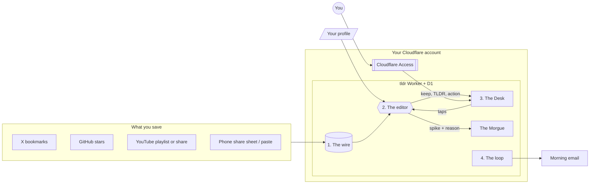

# How it works

## 1. The wire: capture

Every save lands in the `saves` table with status `new`, deduplicated by
source and cleaned link.

- **Phone:** the site installs as an app (PWA) with a share target, so it
  shows up in the share sheet. Shared X posts get their author and text from
  X's public embed endpoint; YouTube links get title and channel from
  YouTube's public oEmbed.
- **X bookmarks:** OAuth 2.0 with PKCE against the official API. A cron reads
  bookmarks every 3 hours and stops at the first page with nothing new.
- **GitHub stars** and an optional **YouTube playlist** sync on the same cron.

## 2. The editor: triage

The editor reads your profile and the last two weeks of your taps, then
judges each new save: **keep** (headline, TLDR, why it matters to you, a rank
from 0 to 100, tags, and at most one action) or **spike** (with a reason).
It finishes with a lede and up to five highlights: the morning run.

Every write goes through the same checks in `src/brain.ts`, whatever runs
the editor:

- **Mode A:** a Claude scheduled task on your own plan calls the tools over a
  remote MCP endpoint at `/mcp/<token>` (`src/mcp.ts`). The prompt is
  `docs/brain-prompt.md`.
- **Mode B:** the Worker's cron calls an AI provider with your key
  (`src/editor.ts`), once a day after `EDITOR_HOUR`, in batches of 20, at most
  100 a day. It only writes ids from the batch it sent, so text inside a save
  can't redirect it to another save.

## 3. The Desk: one page

`/` shows open actions (Done, Snooze 3 days, Drop, each with Undo), then
"Worth reading" by rank, then one line to the Morgue of spiked copy with
Rescue. `/reading`, `/morgue` and `/file` are the back pages. The look follows
`docs/design-brief.md`.

## 4. The loop: keeping it running

The cron (every 3 hours) syncs sources, runs the editor in mode B, moves copy
nobody touched for 30 days into the Morgue, and after 8am local sends one
"no morning run today" email if nothing published. After each run the Worker
emails your Desk; on Sundays it adds a circulation box with the week's counts.

## Privacy

- **Fails closed.** Every request, including the manifest and icons, must
  carry a Cloudflare Access login for `ALLOWED_EMAIL`, verified by the Worker
  itself against Access's signing keys. Without one: an empty 403.
  `workers.dev` and preview URLs are off. The only exception is `/mcp`, which
  has its own long random token and answers an empty 404 without it.
- **What leaves your account:** reads from X, GitHub and YouTube; your
  profile and saves to the editor (your Claude account in mode A, your AI
  provider in mode B); the morning email to your own verified address.
- **Nothing in the repo:** no profile, saves, tokens, account ids or domain.
